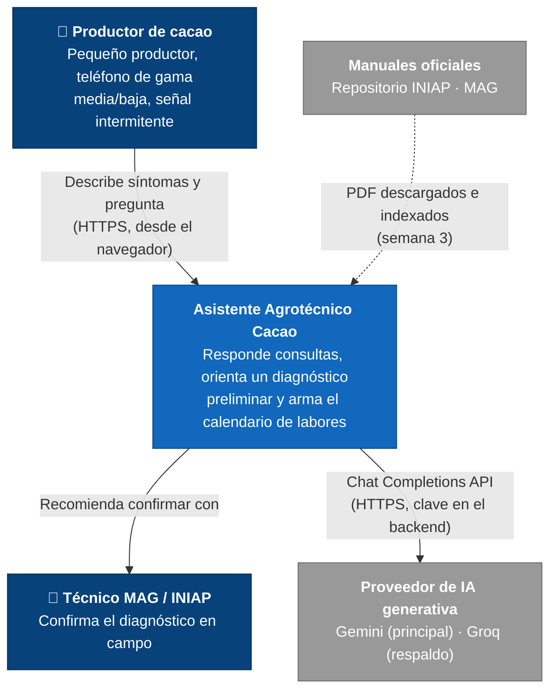
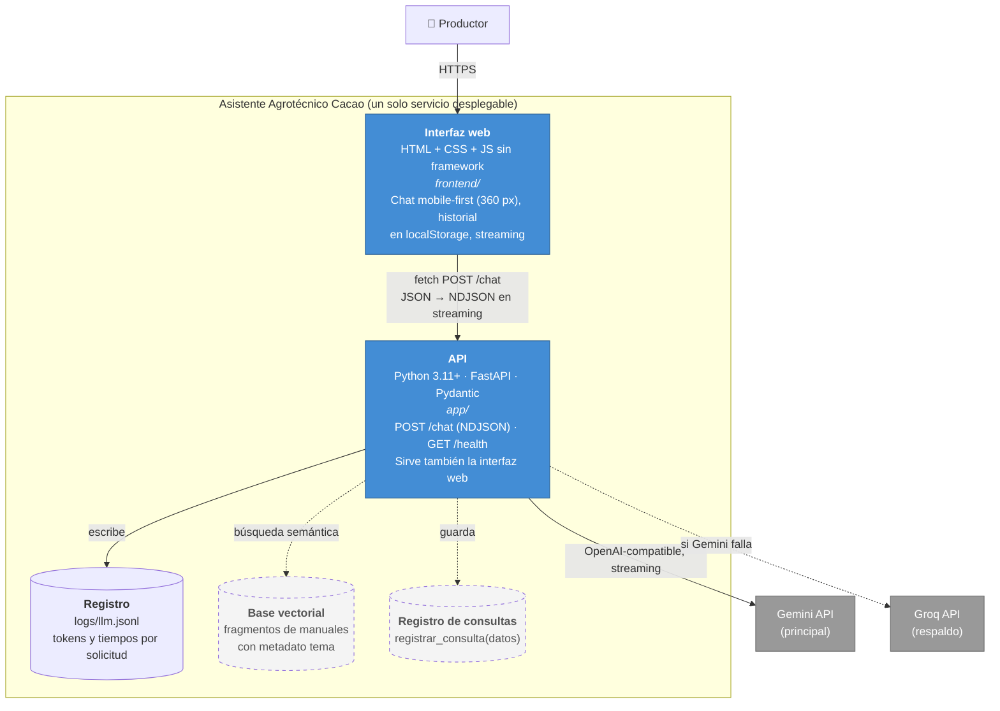
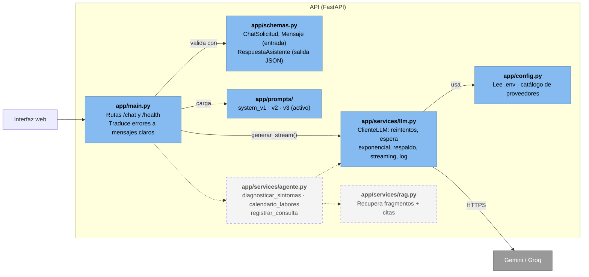
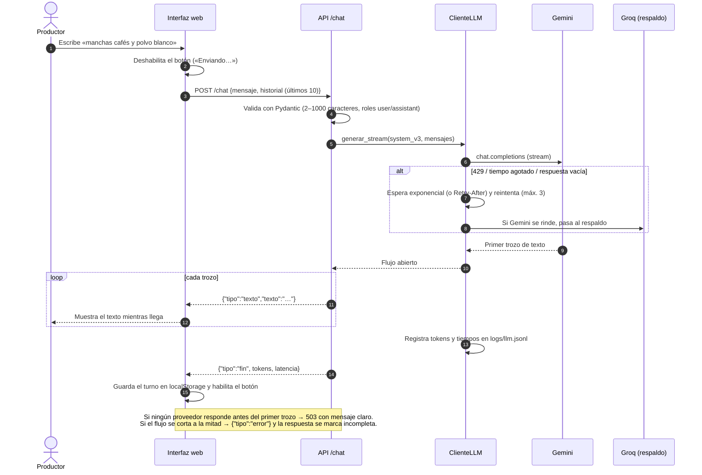

# Arquitectura del Sistema (modelo C4)

El Asistente Agrotécnico para Productores de Cacao es una aplicación web mobile-first con un backend FastAPI que
encapsula al modelo generativo. En la semana 2 funciona como **chat con streaming**; en la semana 3 se agregan el
**RAG con citas** sobre los manuales del INIAP/MAG y el **agente** con sus tres herramientas.

> Convención: los elementos con borde punteado se implementan en la semana 3. Decisiones en
> [09-decisiones.md](09-decisiones.md).

## Nivel 1 · Contexto

## Nivel 2 · Contenedores

## Nivel 3 · Componentes de la API

**Regla de dependencia:** solo `app/services/llm.py` conoce al proveedor. Cambiar de Gemini a Groq u otro proveedor
compatible es cambiar variables del `.env`; los endpoints no se tocan.

## Flujo de una consulta (`POST /chat`)

## Atributos de calidad y cómo se atienden

| Atributo | Mecanismo | Dónde |
| :--- | :--- | :--- |
| Seguridad de la clave | Solo en `.env` / variables de la plataforma; nunca en el frontend | `app/config.py`, `.gitignore` |
| Disponibilidad | Reintentos con espera exponencial, `Retry-After`, proveedor de respaldo | `app/services/llm.py` |
| Consumo excesivo (OWASP LLM10) | Mensaje ≤ 1000 caracteres, historial ≤ 10 turnos, `max_tokens`, tiempo límite | `app/schemas.py`, `.env` |
| Inyección de prompt (LLM01) | El rol `system` solo lo pone el servidor; el prompt ordena ignorar instrucciones del usuario | `app/schemas.py`, `system_v3.md` |
| Salida insegura (LLM05) | La respuesta del modelo se escapa antes de mostrarse (sin HTML crudo) | `frontend/app.js` |
| Desinformación (LLM09) | Sin productos ni dosis; abstención explícita; aviso fijo de orientación preliminar | `system_v3.md`, `frontend/index.html` |
| Usabilidad móvil | Mobile-first 360 px, botones ≥ 44 px, historial disponible sin señal | `frontend/styles.css` |
| Observabilidad | Una línea JSON por llamada: proveedor, intento, tokens, latencia (sin texto del usuario) | `logs/llm.jsonl` |
