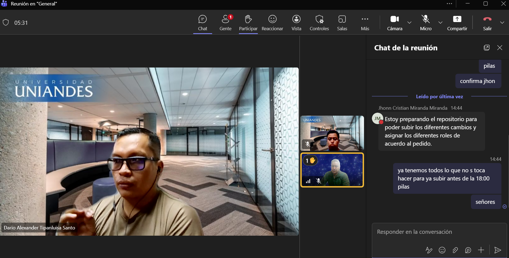
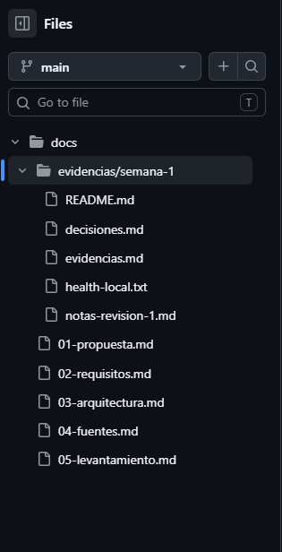

# Evidencias y Registro de Decisiones - Semana 1
**Grupo 9 - Asistente para productores de cacao**

**Integrantes:** Darío Tipanluisa, Jhonn Miranda, Marco Rivas

## 1. Decisiones y Cumplimiento de la Lista de Verificación
Como equipo, organizamos el trabajo para asegurar que todos los puntos obligatorios de la entrega 1 estén completados y subidos al repositorio. Tomamos las siguientes decisiones para la distribución de los entregables:

- **Darío Tipanluisa:**
  - Elaboración de `docs/01-propuesta.md` definiendo el problema real, usuarios, alcance positivo y negativo, riesgos y la justificación del modelo.
  - Redacción de `docs/02-requisitos.md` incluyendo las historias de usuario bajo los criterios «Dado... cuando... entonces...» y los requisitos no funcionales medibles.

- **Jhonn Miranda:**
  - Diseño de `docs/03-arquitectura.md` con el diagrama que detalla el frontend, backend, modelo, base vectorial, herramientas, fuentes y el flujo de consulta.
  - Estructuración de `docs/04-fuentes.md` con el inventario documental (origen, URL, vigencia, formato y fragmentación).
  - Descarga e integración de los documentos oficiales del caso en la carpeta de almacenamiento `data/raw/`.

- **Marco Rivas:**
  - Consolidación del **Levantamiento real** con el mínimo de 15 preguntas frecuentes (ubicado en la carpeta `docs/`).
  - Configuración base de la estructura de carpetas del repositorio mediante la creación de `README.md`, `.gitignore` y `.env.example`.
  - Recopilación, registro de decisiones y estructuración de estas evidencias en la ruta `docs/evidencias/semana-1/`.

- **Canal de comunicación:** Acordamos utilizar Microsoft Teams como herramienta principal para nuestras reuniones de sincronización y la consolidación de los archivos del repositorio.

## 2. Notas de la revisión 1
- **Revisión de integración:** Durante el cierre de la semana, realizamos una revisión cruzada interna verificando que no faltara ningún ítem de la plataforma. Al no haber observaciones adicionales del docente, validamos que la base de conocimiento se limite estrictamente a la documentación de `data/raw/` y aseguramos que el historial de commits refleje la participación de los tres miembros antes de empaquetar el archivo `.zip`.

## 3. Capturas del trabajo colaborativo
*Evidencias visuales de nuestra revisión y coordinación mediante Microsoft Teams:*

- **Reunión de coordinación y definición de la solución:**
  

- **Confirmación de avances y preparación del repositorio:**
  
